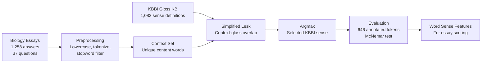

# Indonesian Word Sense Disambiguation for Automatic Essay Scoring

[](https://github.com/haninhammoud01/indonesian-wsd-lesk/actions/workflows/ci.yml)
[](https://www.python.org/)
[](LICENSE)
[]()
[]()

Selecting the correct **KBBI dictionary sense** for ambiguous words in Indonesian biology essays using a simplified Lesk algorithm.

No training data. No GPU. Fully explainable.

This project implements the word meaning component of an automatic essay scoring (AES) pipeline for Indonesian high school biology. Its performance is evaluated against an IndoSBERT baseline using McNemar's statistical test.

> A word like "sel" can refer to a biological cell, a prison cell, or a battery cell. The selected meaning matters because downstream essay scoring depends on understanding the word in its actual context.

## Key Results

**646 manually annotated tokens**

| Configuration | Tokens | Correct | Accuracy |
|---|---:|---:|---:|
| Lesk + Sastrawi stemming (initial) | 646 | 370 | 57.3% |
| Lesk without stemming | 646 | 395 | 61.1% |
| **Lesk without stemming + stopword filter (final)** | **646** | **412** | **63.8%** |
| Final config + IDF weighting (tested, rejected) | 646 | 411 | 63.6% |
| IndoSBERT gloss similarity (baseline) | 646 | 347 | 53.7% |
| Hybrid: Lesk, fallback IndoSBERT on zero overlap | 646 | 357 | 55.3% |

The final rule based system outperforms the IndoSBERT baseline by **10.1 percentage points**. The difference is statistically significant (McNemar **p = 7.8 × 10⁻⁵**).

## Pipeline Architecture

The system uses a dictionary based approach to identify the most appropriate meaning of ambiguous Indonesian words.



### Scoring Rule

The algorithm selects the dictionary sense with the highest word overlap between the sentence context and the corresponding KBBI gloss.

```python
score(sense) = | context_words ∩ words(gloss_sense) |
                → argmax, ties → sense 1
```

- **Context:** Unique content words from the answer sentence, with PySastrawi stopwords removed and word order preserved.
- **Gloss Knowledge Base:** KBBI sense definitions collected into a `word → [sense 1, sense 2, ...]` dictionary containing 1,083 definitions across 273 ambiguous word types.

Two design decisions were validated through ablation experiments:

1. **No stemming:** The Sastrawi stemmer can transform words into forms that no longer match the original gloss text, reducing overlap. Accuracy drops from 63.8% to 57.3% (McNemar p = 3.2 × 10⁻⁴).
2. **Stopword filtering:** Removing high frequency function words from the context improves accuracy from 61.1% to 63.8%.

## Statistical Evaluation: Why McNemar's Test?

Both systems make predictions on the same 646 tokens. Each prediction is a binary outcome: correct or incorrect.

This is paired nominal data, making **McNemar's test** appropriate. The test compares the discordant pairs rather than treating the two systems as independent samples.

### Contingency Table

| | IndoSBERT Correct | IndoSBERT Wrong | Total |
|---|---:|---:|---:|
| **Lesk Correct** | 247 | **165** | 412 |
| **Lesk Wrong** | **100** | 134 | 234 |
| **Total** | 347 | 299 | 646 |

The discordant pairs are:

- b = 165: Lesk correct, IndoSBERT wrong.
- c = 100: Lesk wrong, IndoSBERT correct.

Using the continuity corrected McNemar chi-square statistic:

```text
χ²(1) = (|165 - 100| - 1)² / 265
      = 15.46

Exact binomial p = 7.8 × 10⁻⁵
```

The difference is statistically significant.

The same conclusion holds against the hybrid system (p = 3.0 × 10⁻⁴) and the stemming configuration (p = 3.2 × 10⁻⁴).

All reported statistics are recomputed by `experiments/reproduce_results.py` from `results/predictions_lesk_vs_indosbert.csv`. The GitHub Actions workflow repeats these checks on every push.

## Error Analysis

Understanding where the system fails is as important as measuring its overall accuracy.

### Best Performing Words

Core biology vocabulary performs well because its dictionary definitions contain distinctive scientific terms.

| Word | Tokens | Correct | Accuracy |
|---|---:|---:|---:|
| atp | 10 | 10 | 100% |
| molekul | 19 | 19 | 100% |
| sel | 26 | 24 | 92.3% |
| air | 11 | 10 | 90.9% |
| membran | 19 | 16 | 84.2% |

### Weakest Performing Words

Highly polysemous everyday vocabulary remains challenging.

| Word | Tokens | Correct | Accuracy |
|---|---:|---:|---:|
| dalam | 14 | 0 | 0% |
| tinggi | 12 | 0 | 0% |
| zat | 11 | 0 | 0% |
| konsentrasi | 12 | 2 | 16.7% |

Three patterns emerged from the error analysis:

1. **Core biology terms perform consistently well.** ATP, molekul, sel, and air achieve at least 90% accuracy because their KBBI definitions contain distinctive scientific vocabulary.
2. **Highly polysemous everyday words remain difficult.** Words such as dalam, tinggi, and zat have generic dictionary definitions that share very little vocabulary with biology contexts. Accuracy also decreases as the number of dictionary senses increases: 78.9% (2 senses), 63.3% (3 senses), 60.4% (4 senses), and 54.2% (5+ senses).
3. **Gloss quality influences prediction accuracy.** Tokens whose correct gloss contains a biology term achieve **82.7% accuracy (86/104)**, compared with **60.1% (326/542)** for general language glosses. This motivates the development of a domain specific glossary.

## The IDF Experiment

Inverse Document Frequency (IDF) reduces the weight of words that appear frequently across documents.

The experiment tested whether rare context words could improve the Lesk overlap score.

```python
idf(w) = ln(N / df(w))
```

The following values were measured across the project's gloss and answer corpora.

| Word | Gloss df (N=1,083) | Gloss IDF | Answer df (N=1,258) | Answer IDF |
|---|---:|---:|---:|---:|
| sel | 12 | 4.50 | 750 | 0.52 |
| yang | 256 | 1.44 | 501 | 0.92 |
| osmosis | 0 | — | 92 | 2.62 |
| plasmolisis | 0 | — | 34 | 3.61 |
| homeostasis | 0 | — | 13 | 4.57 |

Adding IDF weighting produces **411/646 correct predictions (63.6%)**, which is statistically indistinguishable from the unweighted version (McNemar p = 1.0).

Only three tokens changed their prediction outcome: two improved and one became incorrect.

The experiment did not improve performance for two reasons:

- The context is already stopword filtered, so most remaining words carry useful information.
- A corpus of 1,083 glosses is relatively small for reliable IDF estimation.

**Decision:** Keep the simpler unweighted model.

IDF may be more useful in the downstream essay scoring stage, where TF-IDF can measure alignment between student answers and teacher answer keys.

## Teacher vs Student Context Consistency

The evaluation initially uses teacher model answers as the context for sense selection.

To investigate whether this approach transfers to actual student responses, sense selection was compared across teacher and student texts.

Across **7,349 word cases**, the system selected identical senses in **90.9% of cases (6,681/7,349)**.

The words molekul, atp, na, and rendah achieved 100% consistency.

These results suggest that the selected context representation generalizes reasonably well to student responses.

Detailed results are available in `results/teacher_student_consistency_top10.csv`.

## Repository Structure

```text
indonesian-wsd-lesk/
├── .github/
│   └── workflows/
│       └── ci.yml
├── data/
│   ├── gloss_kb_sample.csv
│   └── DATA.md
├── src/
│   └── indonesian_wsd/
│       ├── preprocessing.py
│       ├── lesk.py
│       └── evaluation.py
├── tests/
├── demo/
│   └── demo.py
├── experiments/
│   ├── reproduce_results.py
│   └── aes_xlmroberta_exploration.py
├── notebooks/
│   ├── 01_preprocessing_kbbi.ipynb
│   ├── 02_lesk_development.ipynb
│   └── 03_final_pipeline_evaluation.ipynb
├── results/
├── docs/
├── pyproject.toml
└── requirements.txt
```

### Directory Overview

| Directory / File | Description |
|---|---|
| `.github/workflows/` | GitHub Actions CI workflow for linting, tests, demo execution, and statistical verification |
| `data/` | Sample KBBI gloss data and dataset documentation |
| `src/indonesian_wsd/` | Importable Python package containing preprocessing, Lesk, and evaluation modules |
| `tests/` | Unit tests for preprocessing, Lesk decisions, and McNemar evaluation |
| `demo/` | Offline demonstration of the algorithm's sense selection |
| `experiments/` | Reproducibility scripts and early AES exploration |
| `notebooks/` | Data preparation, algorithm development, ablation studies, and final evaluation |
| `results/` | Prediction files, comparison tables, and statistical outputs |
| `docs/` | Architecture diagram source files |
| `pyproject.toml` | Project dependencies and development tool configuration |
| `requirements.txt` | Alternative pip dependency installation |

## Quickstart

Clone the repository and install the project in editable mode.

```bash
git clone https://github.com/haninhammoud01/indonesian-wsd-lesk.git

cd indonesian-wsd-lesk

pip install -e ".[dev]"
```

Alternatively, use uv:

```bash
uv venv
uv pip install -e ".[dev]"
```

### Run the Demo

Watch how the algorithm selects a dictionary sense using the published sample data.

```bash
python demo/demo.py
```

### Reproduce the Results

Recompute the headline statistics from the published prediction files.

```bash
python experiments/reproduce_results.py
```

### Demo Output

The following excerpt illustrates how the same word, "sel", can receive different meanings depending on its context.

```text
Target word : 'sel'

Sentence    : Sel merupakan bagian terkecil penyusun organisme
              yang terdiri atas inti, protoplasma, dan
              dikelilingi membran.

Context     : ['sel', 'terkecil', 'penyusun', 'organisme',
               'inti', ...]

sense 1 | overlap = 2 <-- chosen
         gloss: bagian atau bentuk terkecil dari organisme, ...


Target word : 'sel'

Sentence    : Sel surya adalah alat penghasil tenaga listrik
              melalui reaksi kimia, ...

Context     : ['sel', 'surya', 'alat', 'penghasil',
               'tenaga', 'listrik', ...]

sense 3 | overlap = 6 <-- chosen
         sense 4 | overlap = 1
```

The notebooks require the full dataset, which is not publicly distributed. Refer to `data/DATA.md` for dataset documentation and privacy notes.

The demo, tests, and experiment reproduction scripts operate entirely on the published artifacts.

## Development

The project uses modern Python development tools with a centralized `pyproject.toml` configuration.

| Tool | Purpose |
|---|---|
| Ruff | Linting and code quality |
| Pytest | Automated unit testing |
| GitHub Actions | Continuous integration and reproducibility checks |

Install development dependencies:

```bash
pip install -e ".[dev]"
```

Run the test suite:

```bash
pytest
```

Run the linter:

```bash
ruff check .
```

The CI workflow runs linting, tests, demo execution, and statistical recomputation on every push.

## Roadmap

1. **Domain specific glossary:** Improve sense definitions for highly polysemous words such as dalam, tinggi, and zat. The current error cluster indicates a vocabulary limitation rather than simply an algorithm limitation.
2. **TF-IDF answer key alignment:** Apply IDF weighting to the downstream essay scoring stage, where student answers can be compared with teacher answer keys.
3. **Expanded annotation:** Increase the annotated dataset to support cross-topic and cross-school evaluation, including inter-annotator agreement reporting.

## Author

**Hanin**  
Undergraduate Research | MBKM Program  
Indonesia

Released under the [MIT License](LICENSE).
