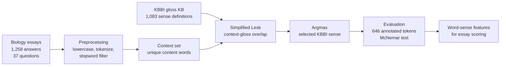

# Indonesian Word Sense Disambiguation for Automatic Essay Scoring

[]()
[]()
[]()
[]()
[]()

Selecting the correct **KBBI dictionary sense** for ambiguous words in
Indonesian biology essays, using a **simplified Lesk algorithm** — no
training data, no GPU, fully explainable. Built as the word-meaning feature
of an **automatic essay scoring (AES)** pipeline for Indonesian high-school
biology, and validated against a sentence-embedding baseline with
**McNemar's test**.

> A word like *"sel"* can mean a biological cell, a prison cell, or a
> battery cell. If the computer picks the wrong meaning, any downstream
> essay scoring inherits the error. This project fixes that step first.

## Key results (646 manually annotated tokens)

| Config | Tokens | Correct | Accuracy |
|---|---:|---:|---:|
| Lesk + Sastrawi stemming (initial) | 646 | 370 | 57.3% |
| Lesk without stemming | 646 | 395 | 61.1% |
| **Lesk without stemming + stopword filter (final)** | **646** | **412** | **63.8%** |
| Final config + IDF weighting (tested, rejected) | 646 | 411 | 63.6% |
| IndoSBERT gloss-similarity (baseline) | 646 | 347 | 53.7% |
| Hybrid: Lesk, fallback IndoSBERT on zero overlap | 646 | 357 | 55.3% |

The final rule-based system **outperforms the IndoSBERT baseline by
+10.1 points** — and the gap is statistically significant
(McNemar **p = 7.8×10⁻⁵**), not sampling luck.

## Pipeline



**Scoring rule** (one line of arithmetic):

```
score(sense) = | context_words ∩ words(gloss_sense) |    →   argmax, ties → sense 1
```

- **Context** = unique content words of the answer sentence
  (PySastrawi stopwords removed, order preserved).
- **Gloss KB** = KBBI sense definitions scraped once into a
  `word → [sense 1, sense 2, ...]` dictionary (1,083 definitions,
  273 ambiguous word types).
- Two deliberate design choices, each verified by an ablation:
  - **No stemming** — the Sastrawi stemmer clips words into forms that no
    longer match the gloss text, destroying overlaps
    (63.8% → 57.3%; McNemar vs final p = 3.2×10⁻⁴).
  - **Stopword filtering** — removing high-frequency function words from
    the context raised accuracy 61.1% → 63.8%.

## Why McNemar and not a t-test?

Both systems predict on **the same 646 tokens**, and each token is a binary
outcome (correct / incorrect). That is *paired nominal data*: the textbook
case for **McNemar's test**, which compares only the discordant pairs.

| | IndoSBERT correct | IndoSBERT wrong | total |
|---|---:|---:|---:|
| **Lesk correct** | 247 | **165** | 412 |
| **Lesk wrong** | **100** | 134 | 234 |
| total | 347 | 299 | 646 |

- b = 165 (Lesk right, IndoSBERT wrong), c = 100 (the reverse)
- χ²(1) = (|165 − 100| − 1)² / 265 = **15.46**, exact binomial
  **p = 7.8×10⁻⁵** → the difference is systematic.
- Same conclusion against the hybrid (p = 3.0×10⁻⁴) and the stemming
  config (p = 3.2×10⁻⁴).

Every statistic here is recomputed live by
`experiments/reproduce_results.py` from
`results/predictions_lesk_vs_indosbert.csv` — and again by CI on every push.

## Error analysis — where the system fails, and why

Best-covered words (core biology vocabulary) — near-solved:

| Word | Tokens | Correct | Accuracy |
|---|---:|---:|---:|
| atp | 10 | 10 | 100% |
| molekul | 19 | 19 | 100% |
| sel | 26 | 24 | 92.3% |
| air | 11 | 10 | 90.9% |
| membran | 19 | 16 | 84.2% |

Weakest words (highly polysemous everyday vocabulary):

| Word | Tokens | Correct | Accuracy |
|---|---:|---:|---:|
| dalam | 14 | 0 | 0% |
| tinggi | 12 | 0 | 0% |
| zat | 11 | 0 | 0% |
| konsentrasi | 12 | 2 | 16.7% |

Three consistent patterns:

1. **Core biology terms are nearly solved** (ATP, molekul, sel, air ≥ 90%):
   their KBBI glosses contain distinctive scientific vocabulary that
   matches the essay context.
2. **Highly polysemous everyday words collapse** (dalam, tinggi, zat = 0%):
   their glosses are generic ("ruang", "berjarak jauh", "bahan") and share
   almost no content words with a biology answer. Accuracy also falls
   monotonically with sense count: 78.9% (2 senses) → 63.3% (3) →
   60.4% (4) → 54.2% (5+).
3. **Gloss quality predicts outcome**: tokens whose correct gloss contains
   a biology term reach **82.7%** (86/104) vs **60.1%** (326/542) for
   general-language glosses — motivating a domain glossary as future work.

## The IDF experiment (why it was tested and rejected)

**Inverse Document Frequency** down-weights words that occur in many
documents: `idf(w) = ln(N / df(w))`. The hypothesis: rare context words
should count more in the Lesk overlap.

Measured on both corpora of this project (see
`results/idf_examples.csv`):

| Word | df in glosses (N=1,083) | IDF | df in answers (N=1,258) | IDF |
|---|---:|---:|---:|---:|
| sel | 12 | 4.50 | 750 | 0.52 |
| yang | 256 | 1.44 | 501 | 0.92 |
| osmosis | 0 | — | 92 | 2.62 |
| plasmolisis | 0 | — | 34 | 3.61 |
| homeostasis | 0 | — | 13 | 4.57 |

Plugging IDF weights into the Lesk score yields **411/646 (63.6%)** —
statistically indistinguishable from the plain count version
(McNemar p = 1.0; only 3 discordant tokens: 2 better, 1 worse).
Why no gain? The context is *already* stopword-filtered, so what remains
is informative by construction — and a 1,083-gloss corpus is too small for
IDF estimates to be reliable. **Decision: keep the simpler model** (Occam
plus identical performance). IDF becomes useful later, at the essay
*scoring* stage as TF-IDF alignment between student answers and teacher
keys — not inside WSD.

## Teacher vs student context consistency

The evaluation context is the teacher's model answer (standardised per
question). Does that transfer to real student essays? Comparing sense
selection on teacher vs student text over **7,349 word cases**: **90.9%**
identical sense (6,681/7,349), with 100% consistency for *molekul*, *atp*,
*na*, *rendah* — so the context choice generalises
(`results/teacher_student_consistency_top10.csv`).

## Repository structure

```
├── .github/workflows/ci.yml     # CI: ruff + pytest + stats recompute on every push
├── data/
│   ├── gloss_kb_sample.csv      # KBBI gloss sample (10 words, 54 senses) — dictionary content only
│   └── DATA.md                  # dataset documentation & privacy notes
├── src/indonesian_wsd/          # importable package (src layout)
│   ├── preprocessing.py         # tokenize, stopword filter, gloss parsing, KB builder
│   ├── lesk.py                  # simplified Lesk + IDF variant
│   └── evaluation.py            # token accuracy, per-word breakdown, McNemar
├── tests/                       # pytest suite (Lesk decisions, preprocessing, McNemar)
├── demo/
│   └── demo.py                  # offline demo: watch Lesk score every sense
├── experiments/
│   ├── reproduce_results.py     # recomputes every README statistic
│   └── aes_xlmroberta_exploration.py  # early AES exploration (XLM-RoBERTa + cosine similarity)
├── notebooks/
│   ├── 01_preprocessing_kbbi.ipynb    # data cleaning + KBBI gloss KB construction
│   ├── 02_lesk_development.ipynb      # ablations: stemming, IDF, stopword filtering
│   └── 03_final_pipeline_evaluation.ipynb  # final config, IndoSBERT baseline, McNemar
├── results/                     # predictions, comparison tables, McNemar JSON
├── docs/                        # architecture diagram source (draw.io)
├── pyproject.toml               # single config: dependencies, ruff, pytest
└── requirements.txt             # plain pip alternative
```

## Quickstart

```bash
pip install -e ".[dev]"        # or with uv: uv venv && uv pip install -e ".[dev]"

# watch the algorithm decide (offline, dictionary-only sample data)
python demo/demo.py

# recompute the headline statistics from published predictions
python experiments/reproduce_results.py
```

Demo output (excerpt) — the same word *"sel"* resolved two different ways:

```
Target word : 'sel'
Sentence    : Sel merupakan bagian terkecil penyusun organisme yang terdiri
              atas inti, protoplasma, dan dikelilingi membran.
Context     : ['sel', 'terkecil', 'penyusun', 'organisme', 'inti', ...]
  sense 1 | overlap = 2 <-- chosen          <- biological cell
          gloss: bagian atau bentuk terkecil dari organisme, ...

Target word : 'sel'
Sentence    : Sel surya adalah alat penghasil tenaga listrik melalui reaksi kimia, ...
Context     : ['sel', 'surya', 'alat', 'penghasil', 'tenaga', 'listrik', ...]
  sense 3 | overlap = 6 <-- chosen          <- battery cell
  sense 4 | overlap = 1
```

The notebooks expect the full dataset (not published, see `data/DATA.md`)
placed next to them; `demo/`, `tests/` and `experiments/` run entirely on
the published artifacts.

## Development

Modern Python tooling is wired up: single-source `pyproject.toml`, `ruff`
(the Rust linter that replaced black/flake8/isort in most teams), `pytest`,
and a GitHub Actions workflow that lints, runs the tests, re-runs the demo
and recomputes the McNemar statistics on every push.

```bash
pip install -e ".[dev]"
pytest          # unit tests
ruff check .    # lint
```

## Roadmap

1. **Domain glossary** for polysemous everyday words (dalam, tinggi, zat) —
   the 0% cluster is a vocabulary problem, not an algorithm problem.
2. **TF-IDF answer-key alignment** for the essay scoring stage, where IDF
   actually has enough data.
3. **More annotation** to enable cross-topic and cross-school evaluation,
   plus inter-annotator agreement reporting.

## Author

Built by **Hanin** — undergraduate research (MBKM program), Indonesia.
Code and experiments are released under the [MIT License](LICENSE).
